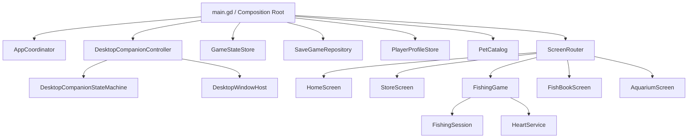

# Desktop Pet

[English](README.md) | [Chinese documentation](docs/README.zh-CN.md)

[](https://github.com/yufanmo219/DesktopPet/actions/workflows/ci.yml)

Desktop Pet is a cozy 2D virtual companion game for Windows and macOS, built
with Godot 4.7. It combines a native desktop companion with a small collection
of relaxing activities: adopting cats, fishing, building a fish collection,
and decorating an aquarium.

> **Project status:** active pre-release development. The source is available
> for portfolio and evaluation purposes; signed public binaries are not yet
> published.

## Highlights

- Nine cat profiles backed by a centralized, lazily loaded pet catalog.
- A transparent desktop companion with draggable station and pet windows,
  multi-display support, follow mode, sleep behavior, and automatic return.
- A level-based fishing game with fish rarity, goals, retries, XP rewards,
  heart recovery, discovery popups, and deterministic session rules.
- A Fishipedia and aquarium backed by the same persistent player progress.
- Local-only JSON saves with atomic replacement, backup recovery, legacy-save
  migration, and protection against overwriting saves from newer versions.
- Cross-platform tests and reproducible unsigned QA exports for Windows and
  macOS.

## Gameplay

The application opens on the Home screen with Maple as the default companion.
From there, players can:

- adopt and select companions from the Cat Shelter;
- earn XP and discover fish through Fishing;
- browse unlocked species in the Fishipedia;
- choose fish to display in the Aquarium; and
- keep the active companion on the desktop while using other applications.

All player data stays on the local machine in Godot's `user://` directory. The
game does not require an account, server, or database.

## Run from source

### Requirements

- [Godot 4.7.1](https://godotengine.org/)
- [Git LFS](https://git-lfs.com/)
- Python 3 for tests and export helpers

```bash
git lfs install
git clone https://github.com/yufanmo219/DesktopPet.git
cd DesktopPet
git lfs pull
```

Import `project.godot` in Godot and run `main.tscn`, or press `F6`/`F5` in the
editor.

When the editor embeds the game, choosing **Keep as desktop companion** starts
the companion in a separate transparent process. You can also disable
**Embed Game on Next Play** from the Godot **Game** menu.

## Architecture



The runtime is organized around small domain services and composed Godot
scenes. UI scenes render and forward input; persistence, progression, roster,
desktop behavior, and fishing rules live in independently testable classes.

See [Architecture](docs/architecture.md) for responsibilities, dependency
boundaries, and extension guidance.

## Validation

Run the complete test suite:

```bash
python3 tools/run_tests.py
```

Run selected tests:

```bash
python3 tools/run_tests.py --test save_game_repository
python3 tools/run_tests.py --test fishing_session
python3 tools/run_tests.py --test desktop_companion_state_machine
```

The runner imports Godot resources once before executing isolated tests. GitHub
Actions runs the same suite on macOS and Windows and verifies both Git LFS
objects and the direct-Git blob-size policy.

## QA builds

Install the Godot 4.7.1 export templates, then run:

```bash
python3 tools/export_builds.py --target windows
python3 tools/export_builds.py --target macos
```

Generated files remain under the ignored `build/` directory. The repository's
manual **QA builds** workflow produces unsigned/ad-hoc artifacts for testing;
these artifacts are not production releases. See [Release process](docs/release.md)
for signing and notarization requirements.

## Repository layout

```text
src/app/          application coordination and screen routing
src/desktop/      desktop companion behavior and native window integration
src/fishing/      fishing domain model and composed UI scenes
src/persistence/  durable local-save repository
src/pets/         pet definitions and catalog
src/profile/      owned-pet roster and active-companion rules
src/progression/  typed progress and heart recovery
tests/            standalone Godot tests
tools/            validation, asset, and export utilities
docs/             architecture, release, and localized documentation
```

## Contributing and security

Read [CONTRIBUTING.md](CONTRIBUTING.md) before proposing a change. Please report
security or privacy issues according to [SECURITY.md](SECURITY.md), not through
a public issue.

## License

Copyright © 2026 Yufan Mo. All rights reserved.

This repository is public for viewing and portfolio evaluation. Public access
does not grant permission to copy, redistribute, publish, sell, or reuse the
source code, artwork, animation, audio, or fonts. See [LICENSE](LICENSE) for the
full notice.
